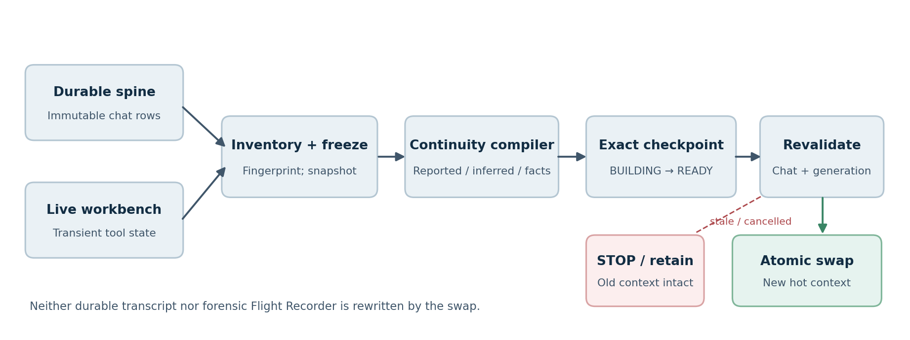
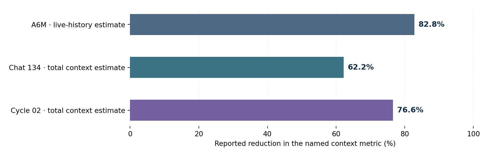

**Research preprint · Working manuscript, v1.0 · Not peer reviewed**
**Project:** [Lumina AI](https://github.com/Bino5150/lumina) · **Implementation:** open-source Git history and project technical evidence
**Code repository:** https://github.com/Bino5150/lumina
**Author affiliation:** Independent developer, Lumina project
**Disclosure:** ChatGPT assisted with literature identification, manuscript structuring, editorial drafting, and figure preparation. The named human author is responsible for review, accuracy, attribution, and any submission. No new experiments were performed in preparing this manuscript.

> *Clean the workbench. Keep the blueprint.*

# 1. Introduction

Long-horizon agent sessions are not simply long conversations. Beyond user and assistant messages they can contain chains of tool calls, tool results, temporary scaffolding, intermediate model outputs, provider-specific request items, and diagnostic telemetry. Some of this information is important to the next decision; much of it is an execution trace that need not appear in every future prompt. Persisting such trace material is not the same as repeatedly placing it in the model's active context.

A long context window is helpful but does not settle the selection problem. Prior work has documented challenges in the use of distant context, including positional sensitivity [1], while research on agent memory and memory tiers has established the value of state external to the immediate prompt [2,3]. Prompt compression methods such as LLMLingua and LongLLMLingua address related token-budget problems [4,5]. Reforge addresses a narrower **systems-lifecycle** question: how can a running agent replace an execution-heavy active workbench with a validated continuation context **without rewriting its durable conversation or treating inferred content as authority**?

We describe an implemented mechanism in the local-first Lumina agent. The work contributes: (i) a three-layer state model distinguishing durable dialogue, checkpointed continuation, and ephemeral execution work; (ii) an exact-state, fail-closed reconstruction transaction; (iii) a retrospective evaluation of live context reductions and blind continuity probes, including a negative result; and (iv) an explicit set of validity limits and repeat-cycle benchmarks that remain to be run.

The reported measurements are an **engineering case study**, not a randomized controlled trial. In particular, successful persistence of the original transcript does not prove that every ephemeral fact was recoverable by the post-reconstruction model.

# 2. Related work and design position

**Memory-tier and cognitive-agent architectures.** MemGPT treats context as a managed memory hierarchy, transferring information between limited working context and other stores [2]. The CoALA framework distinguishes memory and action components within language-agent architectures [3]. Reforge shares the principle that information outside the active prompt can remain accessible, but emphasizes an operator-authorized, checkpoint-bound **replacement of the active runtime workbench**, including validation of concurrent session state.

**Prompt compression and context selection.** LLMLingua compresses prompts using token-level techniques and budget control [4], while LongLLMLingua targets long-context prompts and positional effects [5]. These approaches primarily optimize **what text is sent**. Reforge instead orchestrates **which state objects** are admitted, the provenance of their contents, and whether a new workbench may replace the current one safely. The two families are complementary; no quantitative superiority is claimed here.

**Long-range memory evaluation.** *Lost in the Middle* reports that relevant information can be difficult for models to use depending on where it appears [1]. LoCoMo provides tasks spanning long conversational histories and temporal/causal recall [6]. These motivate evaluating **recoverability and task fidelity**, not just total tokens. More recent autonomous-compression work, including Focus [7], underscores the importance of measuring task outcomes as well as reduction. Provider-native compaction systems offer another operational baseline [8]. This manuscript does not report head-to-head tests with any of these methods.

**Specific contribution boundary.** Reforge does **not** introduce the concepts of external memory, summarization, or context thinning. Its reported contribution is the **combination** of exact durable-state binding, a provenance-separated continuity artifact, and transactional live-context replacement, implemented within a persistent desktop agent and evaluated with operational receipts.

# 3. State model and correctness contract

The mechanism models three layers:

1. **Durable conversational spine (D).** The stored conversation record, backed by persistent chat rows, continues to exist after context reconstruction.
2. **Continuity checkpoint (C).** A bounded, provenance-aware artifact compiled from durable state, selected recent execution evidence, and machine-derived facts. It is anchored to the exact state from which it was derived.
3. **Ephemeral execution workbench (E).** The active in-memory history used for ongoing inference, including tool traces and provider-specific artifacts.

The reconstruction operation replaces **E**, not **D**. Forensic execution history is maintained separately through Lumina's Flight Recorder. A checkpoint is a continuation artifact, not a wholesale claim that every past event was remembered.

Four invariants define an accepted transaction:

- **State identity:** the target chat, durable-state fingerprint, checkpoint ID, and context generation match the intended reconstruction.
- **Bounded provenance:** model-extracted reported/inferred material remains distinguishable from machine facts; external text and tool outputs never become owner authorization.
- **Fail-closed replacement:** stale, failed, cancelled, switched-chat, or emergency-stopped operations leave the existing live workbench intact.
- **Evidence-bearing success:** the result is documented by machine-derived before/after receipts, not inferred from an assistant's narrative.

A key semantic boundary follows: **durable transcript integrity is a structural property; answer fidelity is a behavioral property.** The first can be checked transactionally. The second requires questions, tasks, and external answer keys.

# 4. Reforge architecture

*Figure 1. The durable spine and a bounded snapshot of the current workbench are inventoried and fingerprinted, compiled into an exact checkpoint, and revalidated immediately before an atomic swap. Rejection or cancellation retains the original workbench.*

## 4.1. Inventory, snapshot, and fingerprint

The coordinator freezes the relevant chat identity and durable-state view and captures the currently relevant execution workbench. The fingerprint guards against consuming a continuation artifact that was compiled for a different or subsequently modified conversation. This also distinguishes two kinds of concurrency: a checkpoint can be internally well formed and still be **stale** by the time the agent attempts to use it.

## 4.2. Provenance-aware continuity compilation

The compiler receives a bounded selection of recent durable dialogue, workbench activity, and verified machine facts. Its output keeps **reported** source material, **inferred** conclusions, and **machine facts** conceptually separate. The model may identify candidate continuity content; trusted code, rather than model prose, supplies the machine facts. The documented implementation bounds the compiler input to approximately 8,000 tokens, allows up to three utility attempts, targets roughly 4 KiB output, and enforces a 16 KiB ceiling. These are implementation parameters rather than generally optimal values [S1].

## 4.3. Exact checkpoint and transaction

Each owner-invoked `/context rebuild` compiles a **fresh checkpoint**. The coordinator consumes the exact newly produced ID rather than selecting any convenient ready checkpoint. It verifies identity, freshness, active chat, context generation, cancellation, and emergency-stop state before replacement. If any check fails, the old context is retained.

In simplified notation, with `valid(D, C, E)` requiring all bindings and guards:

\[
E_{t+1}=\begin{cases}
\operatorname{rebuild}(D_t,C_t), & \text{if valid}(D_t,C_t,E_t),\\
E_t, & \text{otherwise.}
\end{cases}
\]

This expression describes the intended transactional contract, not a formal proof of all implementation paths. The coordinator emits a receipt containing checkpoint identity, context generations, live-history entry counts and token estimates, durable-state fingerprint, and terminal status [S1].

## 4.4. Execution, authorization, and shipping boundary

As of the reference release, Reforge is an **owner-triggered desktop command**: `/context`, `/context status`, and `/context rebuild`. It is not a remotely invocable Telegram command or a model-callable tool. Unattended automatic reconstruction is **not** described as shipped. The relevant implementation modules include `core/context_inventory.py`, `core/continuity_compiler.py`, `core/context_checkpoints.py`, `core/context_transaction.py`, and `core/context_rebuild.py`. Historical source and implementation commits are indexed in Appendix A.

# 5. Retrospective evaluation

## 5.1. Evidence base and measurement definitions

We analyze previously documented operational observations compiled in the Lumina Reforge technical reference [S1]. They cover an early lifecycle experiment, an owner-operated A6M shakedown, an organic engineering session (Chat 134), and a blinded three-category continuation probe (Cycle 02). The record reports **estimated active context**, generally separated into **live-history** and **total active context**. These are not audited provider billing-token counts, GPU-memory benchmarks, or equivalent measures across all runs.

For before/after estimates \(T_{pre}\) and \(T_{post}\), reported reduction is:

\[
R=100\times\left(1-\frac{T_{post}}{T_{pre}}\right)\%.
\]

The retrospective nature of the data means model identities, tokenizer estimators, provider caching, evaluation random seeds, and all raw logs are not consistently specified in the present source document. Those omissions limit independent replication and inference about cost or runtime speed. The paper uses the original reported precision and labels denominators explicitly.

## 5.2. Structural and active-context observations

| Specimen | Context metric | Before | After | Reported reduction | Durable transcript |
|:--|:--|--:|--:|--:|:--|
| A6M owner shakedown, Sep. 4 | Estimated **live-history** tokens | ~31.9k | ~5.5k | **82.8%** | Unchanged |
| Organic Chat 134, Sep. 12 | Estimated **total active** context | ~239.1k | ~90.4k | **62.2%** | Unchanged |
| Blind Cycle 02, Sep. 14 | Estimated **total active** context | ~519.6k | ~121.5k | **76.6%** | Unchanged |

*Table 1. Three nonidentical retrospective specimens. The A6M denominator is live-history tokens; the other rows measure total active context. They must not be pooled into a single mean or a cross-method performance claim. All values derive from [S1].*

*Figure 2. Individual reported percentage reductions; bars summarize different context measurements and are not a pooled estimate.*

The initial lifecycle observation provided a separate clue: a 42-minute engineering workload grew to 115,116 active tokens and returned at approximately 46k after the same persisted chat was re-entered (approximately 60% reduction). In a follow-up, unloading and re-entering a chat changed an 83,710-token active history to approximately 59.5k, while a subsequent full process restart changed it only to approximately 59.3k. These observations motivated explicit **chat/workbench reconstruction**, rather than treating process restart itself as the relevant mechanism [S1]. They are historical design observations, not additional independent Reforge treatment results.

## 5.3. Organic Chat 134 continuity test

Chat 134 represented a naturally occurring engineering workload with source inspection, tool activity, background processing, runtime forensics, and normal dialogue. Its live-history estimate declined from approximately 172.1k to 23.3k tokens and entries from 192 to 25, while total active context declined from approximately 239.1k to 90.4k. A before/after 18-question questionnaire matched on material facts. **However, the pre-reconstruction answer set had itself become part of the durable conversation**, contaminating a strict test of ephemeral-only recovery. Accordingly, the result supports useful durable continuity and structural shedding but cannot establish perfect recovery of hidden ephemeral state [S1].

## 5.4. Cycle 02 hidden-answer-key continuity probe

Cycle 02 deliberately separated information into three categories: **A**, a durable control; **B**, task-critical information present only in ephemeral state; and **C**, disposable ephemeral telemetry. An answer key was held outside the evaluated agent. Checkpoint #13 reconstructed live entries from 294 to 55; the total active-context estimate declined from approximately 519.6k to 121.5k. External invariant inspection indicated prior checkpoint rows, memories, knowledge, skills, people/profile data, and the durable transcript prefix were not retroactively modified; later transcript rows remained append-only [S1].

| Hidden category | Required behavior | Observed result | Assessment |
|:--|:--|:--|:--|
| A: durable engineering identifiers | Exact recovery of prior release/dev commit hashes | Both hashes recovered | **Pass** |
| B: task-critical ephemeral continuation | Recover exact `tcpdump -U` / `--packet-buffered` flag and why the capture needs it | Required flag/payload unavailable; no false substitution | **Strict miss** |
| C: disposable transient telemetry | Do not fabricate exact duration, thinking-time, and first-token timing | Values reported unavailable without estimates | **Pass** |

*Table 2. One hidden-answer-key question per category. The A/B/C test is a useful diagnostic case, not a statistically powered fidelity benchmark.*

The B failure is important. The missing `-U` / `--packet-buffered` flag was needed to preserve a packet-buffered capture tail relevant to a pending networking investigation. It was neither suitable for permanent conversational memory nor safely disposable while the task remained open. Reforge did **not** recover it. The model also did **not** guess a plausible flag or invent the supporting rationale. Thus this case demonstrates improved **epistemic restraint** in a missing-detail scenario, **not** successful preservation of every task-relevant fact.

# 6. Interpretation and failure modes

## 6.1. Why reducing a workbench differs from compressing a transcript

The system's main target is **execution-state accumulation**. Dropping completed tool traces and provider-specific artifacts can be appropriate even when a durable conversation should remain accessible. The retained checkpoint selectively carries continuation information rather than attempting to summarize all historical tokens. Conventional compaction still has a distinct role for conversational-prefix pressure; the shipped Lumina system has separate manual `/compact` and automatic trim-compaction pathways [S1]. Reforge supplements rather than replaces them.

## 6.2. Correct forgetting, honest gaps, and strict-B loss

For a persistent agent, retention quality should not be scored by maximal recall. Exact durable identifiers should survive. Disposable telemetry may rightly vanish. Task-critical ephemeral particulars occupy a third class: **minimum continuation payload**. Cycle 02 shows that missing this class can impair resumption even when all structural checks pass. Candidate future mechanisms include a small validated continuation capsule or pending-action ledger containing a verified finding, exact source/identifier, its relevance to the next action, and verification status. Neither is claimed as shipped.

## 6.3. Potential, not yet measured, resource benefits

A smaller prompt can reduce input volume and pressure on local prompt prefill and KV-cache capacity; it may also reduce uncached cloud input costs. The included experiments did **not** control GPU memory, tokens billed, time-to-first-token, total latency, provider prefix-cache hits, or end-to-end cost. Because rebuilding a prefix can reduce cache reuse, even a large token-count reduction is not necessarily an economic win. Automated triggers would require explicit benefit, cost, cancellation, and task-fidelity policies, not a single token threshold.

# 7. Threats to validity and scope

**Limited samples and selection.** The case study uses a small number of developer-operated examples, including a high-value organic session selected because it had accumulated a large workbench. The 3-item blind probe cannot estimate fidelity rates or generalize to arbitrary tasks, languages, providers, or agents.

**Unequal denominators and approximate metering.** The A6M reduction refers to live-history tokens, while Chat 134 and Cycle 02 refer to total context estimates. The estimator, tool-schema overhead, cache behavior, and billing tokenization are not controlled across trials. Percentages are therefore descriptive, not directly comparative.

**No controlled baseline.** No matched randomization, equivalent-trajectory comparison with `/compact`, LLMLingua, MemGPT, or provider-native compaction, or independent evaluator replication is reported. The data cannot support a claim of superior fidelity or lower latency/cost.

**Continuity contamination and incomplete provenance.** Chat 134's before-test answer set was made durable prior to reconstruction. Cycle 02 mitigated that specific weakness through an external key, but the available public technical reference does not include all raw event streams, inference parameters, or reproducibility scripts. Internal validation artifacts are referenced by title rather than publicly reproduced in this preprint.

**Semantics versus structure.** Checkpoint freshness, durable-row invariants, and a successful atomic swap cannot ensure perfect semantic or code-detail preservation. The strict-B miss is an explicit counterexample to a lossless-context claim.

**Repeated cycles not established.** The record includes multiple Reforge operations and historically numbered checkpoints, but it does **not** provide a controlled longitudinal experiment showing fidelity retained across repeated successive reconstructions of the same evolving task. The manuscript consequently does not claim immunity from cumulative semantic drift or hallucination.

# 8. Prospective evaluation protocol

A stronger evaluation should use paired, comparable long-horizon tasks under (i) full-history continuation until feasible, (ii) conventional `/compact`, and (iii) Reforge, with a matched budget and explicit reconstruction triggers. At least 5–10 successive cycles per task should be monitored, with multiple task types and model/provider conditions. Independent answer keys should be prepared **before** each reduction and withheld from the agent.

Each cycle should label facts as **A: durable**, **B: essential ephemeral continuation**, or **C: intentionally disposable**, and score exact preservation, semantic preservation, partial continuity, correct absence, hallucinated recovery, and contradiction as separate outcomes. Task-quality endpoints should include executable code or plan correctness where appropriate, not merely recall of named facts. Report per-cycle and cumulative error, failed/aborted transactions, prompt tokens, model-call overhead, cache hits where available, and end-to-end time and cost. Every score should distinguish **unavailable** from **wrongly asserted** details.

This design would test the motivating working theory: whether transactional reconstruction reduces active context **with less continuity degradation across repeated cycles** than summary-based alternatives. That remains a hypothesis, not an established result.

# 9. Conclusion

Lumina Reforge demonstrates an implemented alternative to treating an ever-growing agent execution trace as permanent prompt context. It reconstructs a smaller hot workbench from durable conversation and a provenance-aware checkpoint, requires exact state binding, and conditionally commits the replacement only when runtime identities and safety conditions still hold. In the reported cases, estimated active context declined substantially without deleting the durable conversation. The blind test simultaneously demonstrates the design's promise and its boundary: verified durable facts survived, disposable telemetry was honestly absent, and one exact task-critical ephemeral fact was lost. The appropriate claim is therefore **transactional, auditable working-set reduction with measured case-specific continuity**, not lossless memory. Controlled comparative and repeated-cycle evaluation is the necessary next research step.

# References

[1] Liu, N. F., Lin, K., Hewitt, J., Paranjape, A., Bevilacqua, M., Petroni, F., and Liang, P. (2024). **Lost in the Middle: How Language Models Use Long Contexts.** *Transactions of the Association for Computational Linguistics*, 12, 157–173. https://doi.org/10.1162/tacl_a_00638

[2] Packer, C., Wooders, S., Lin, K., Fang, V., Patil, S. G., Stoica, I., and Gonzalez, J. E. (2023). **MemGPT: Towards LLMs as Operating Systems.** arXiv:2310.08560. https://arxiv.org/abs/2310.08560

[3] Sumers, T. R., Yao, S., Narasimhan, K., and Griffiths, T. L. (2024). **Cognitive Architectures for Language Agents.** *Transactions on Machine Learning Research* (camera-ready version identified at arXiv:2309.02427). https://arxiv.org/abs/2309.02427

[4] Jiang, H., Wu, Q., Lin, C.-Y., Yang, Y., and Qiu, L. (2023). **LLMLingua: Compressing Prompts for Accelerated Inference of Large Language Models.** *Proceedings of EMNLP*, 13358–13376. https://doi.org/10.18653/v1/2023.emnlp-main.825

[5] Jiang, H., Wu, Q., Luo, X., Li, D., Lin, C.-Y., Yang, Y., and Qiu, L. (2024). **LongLLMLingua: Accelerating and Enhancing LLMs in Long Context Scenarios via Prompt Compression.** *Proceedings of ACL*. https://aclanthology.org/2024.acl-long.91/

[6] Maharana, A., Lee, D.-H., Tulyakov, S., Bansal, M., Barbieri, F., and Fang, Y. (2024). **Evaluating Very Long-Term Conversational Memory of LLM Agents.** *Proceedings of ACL*, 13851–13870. https://doi.org/10.18653/v1/2024.acl-long.747

[7] Verma, N. (2026). **Active Context Compression: Autonomous Memory Management in LLM Agents.** arXiv:2601.07190. https://arxiv.org/abs/2601.07190

[8] OpenAI (2026). **From model to agent: Equipping the Responses API with a computer environment.** Engineering description of provider-native compaction. https://openai.com/index/equip-responses-api-computer-environment/

# Appendix A. Provenance and reproducibility record

**Primary technical source.** [S1] *Lumina Reforge — Transactional Context Reconstruction: Technical Architecture & Empirical Validation Reference*, v1.0, dated 26 September 2026, supplied by the project owner. This is the direct source for the reported numeric results, implementation summary, experimental caveats, and internal artifact titles. This research manuscript paraphrases and reorganizes its evidence; it does not claim to have rerun the tests or independently inspected every historical runtime receipt.

**Public implementation chronology from [S1].** The foundational context-lifecycle implementation was recorded in `2682ce31b713ffdbc8be4105128555a6c09bb9a2` (Aug. 31, 2026). The owner-facing `/context rebuild` command appeared in `3c72e016490a8672478f18ae27dc8f08465d3905` (Sep. 3, 2026). Earlier compaction pathways are documented at `714ae5fa99dbd655770de6e39320742e18f8c1e4` and `8b2b7d243e03fcfaa4634ecbb0fd31ab56e0ee47`. These hashes and dates are transcribed from [S1]; independently verifying repository state at publication time is advisable.

**Implementation pointers.** Repository: https://github.com/Bino5150/lumina; [owner-facing Reforge commit](https://github.com/Bino5150/lumina/commit/3c72e016490a8672478f18ae27dc8f08465d3905); [context reconstruction source snapshot](https://github.com/Bino5150/lumina/blob/fa1202b136c0ef2446bd208a41517057b0cea2e5/core/context_reconstruction.py); [continuity compiler snapshot](https://github.com/Bino5150/lumina/blob/fa1202b136c0ef2446bd208a41517057b0cea2e5/core/continuity_compiler.py); [context transaction snapshot](https://github.com/Bino5150/lumina/blob/fa1202b136c0ef2446bd208a41517057b0cea2e5/core/context_transaction.py).

**Named evidence artifacts held by the project.** `LUMINA_CONTEXT_LIFECYCLE_A6M_EMPIRICAL_VALIDATION_REPORT_2026-09-04.md`; `LUMINA_A6M_ADVERSARIAL_REVIEW_ADDENDUM_2026-09-04.md`; `LUMINA_REFORGE_EMPIRICAL_VALIDATION_CHAT_134_2026-09-12.md`; and `LUMINA_REFORGE_CYCLE_02_EMPIRICAL_VALIDATION_2026-09-14.md`. These are listed for provenance, **not** asserted to be a public anonymized dataset. Releasing excerpts should be preceded by a credentials, privacy, and owner-authority review.

**Reproducibility status.** *Partial.* Architectural code and dated commits are referenced, and reported before/after observations and blind scoring are described. A third party would need a published, anonymized evaluation harness, tokenizer definitions, exact model settings, independent answer keys, and released receipts to repeat or independently audit the numeric claims. No DOI, arXiv identifier, or peer-reviewed status has been assigned to this manuscript.

# Appendix B. Research claims register

| Claim | Current evidentiary status |
|:--|:--|
| Reforge replaces the active workbench without deleting the durable chat record | **Implemented design; supported by operator receipts and reported invariants** |
| Two measured cases reduced estimated total active context by 62.2% and 76.6% | **Observed in cited retrospective cases** |
| A6M reduced estimated live-history tokens by 82.8% | **Observed, different denominator** |
| Durable engineering identifiers remained answerable after Cycle 02 | **One blinded-control pass** |
| Exact task-critical ephemeral details always survive | **Contradicted by strict-B miss** |
| Reforge never hallucinates across repeated cycles | **Not established** |
| Reforge beats conventional compaction in fidelity or cost | **Not tested comparatively** |
| Manual owner-triggered Reforge is shipped; automatic Reforge is shipped | **First supported; second not claimed** |
| Reduced context necessarily produces lower billing or latency | **Not established; caching/provider effects unresolved** |
